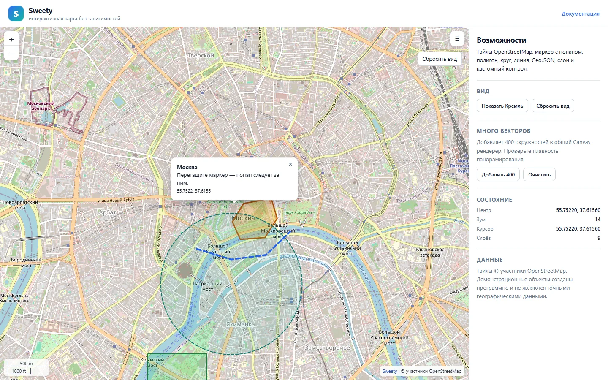

<p align="center">
  
</p>

<h1 align="center">Sweety</h1>

<p align="center"><strong>Модульная JavaScript-библиотека интерактивных карт без runtime-зависимостей.</strong></p>

Ядро API — центральный класс `Map`, слои, контролы, события и плагины. Библиотека
поставляется в виде ES-модулей и UMD-сборки, а для стилей используется отдельный
CSS-файл.

<p align="center">
  <a href="https://github.com/brainstable/sweety/actions/workflows/ci.yml"></a>
  <a href="LICENSE"></a>
</p>

## Возможности

- **Ядро карты**: центр, зум, `minZoom`/`maxZoom`, `maxBounds`, `setView`, `panTo`,
  `flyTo`, `fitBounds`, `flyToBounds`, `invalidateSize`.
- **Жесты**: перетаскивание мышью и указателем, инерция, колесо, двойной клик,
  pinch-зум двумя пальцами, плавная CSS-анимация зума.
- **Слои**: `TileLayer`, `Marker`, `Popup`, `Tooltip`, `Polyline`, `Polygon`,
  `Circle`, `Rectangle`, `LayerGroup`, `FeatureGroup`, `GeoJSONLayer`.
- **Рендеринг векторов**: общий SVG-рендерер и Canvas-рендерер с hit-testing.
- **Тайлы**: XYZ-шаблоны, субдомены, TMS, retina-суффикс `{r}`, кэш изображений,
  повторные попытки загрузки, виртуализация видимых тайлов.
- **Координаты**: `LatLng`, `Point`, `Bounds`, проекции EPSG:3857 и EPSG:4326.
- **Контролы**: зум, атрибуция, масштаб, переключатель слоёв и кастомные контролы
  в четырёх углах.
- **Расширяемость**: `Evented`, `Map.addInitHook`, реестр плагинов `use`.
- **Качество**: 130+ unit/integration-тестов на Vitest и jsdom, ESLint, Prettier,
  GitHub Actions, Conventional Commits и commitlint.

## Установка

```bash
npm install sweety-map
```

```js
import { Map, TileLayer, Marker } from 'sweety-map';
import 'sweety-map/dist/sweety.css';
```

Runtime-зависимостей нет. Для разработки нужен Node.js ≥ 20.19.

### UMD-сборка

```html
<link rel="stylesheet" href="./dist/sweety.css" />
<script src="./dist/sweety.umd.js"></script>
<script>
  const map = new Sweety.Map('map', { center: [55.75, 37.61], zoom: 10 });
  new Sweety.TileLayer('https://{s}.tile.openstreetmap.org/{z}/{x}/{y}.png', {
    attribution: '&copy; участники OpenStreetMap',
  }).addTo(map);
</script>
```

> В npm-пакете UMD-файл называется `sweety.umd.cjs` для корректного `require()`.
> Скрипт сборки дополнительно создаёт браузерную копию `sweety.umd.js`.

## Быстрый старт

```js
import { Map, TileLayer, Marker } from 'sweety-map';
import 'sweety-map/dist/sweety.css';

const map = new Map('map', {
  center: [55.75, 37.61],
  zoom: 10,
  minZoom: 3,
  maxZoom: 18,
});

new TileLayer('https://{s}.tile.openstreetmap.org/{z}/{x}/{y}.png', {
  attribution: '&copy; участники OpenStreetMap',
}).addTo(map);

const marker = new Marker([55.75, 37.61], { draggable: true }).addTo(map);

marker.bindPopup('Привет!');
marker.bindTooltip('Перетащите меня', { permanent: true, direction: 'top' });

map.on('click', (event) => {
  console.log(event.latlng.lat, event.latlng.lng);
});
```

```html
<div id="map" style="height: 480px"></div>
```

Контейнер должен иметь явную высоту. `Map` принимает id строкой или сам
`HTMLElement`.

## Демо

```bash
npm install
npm run dev
```

Vite откроет `http://localhost:5173/examples/`. Демо содержит карту OSM, маркер
с попапом и tooltip, полигон, круг, линию, GeoJSON, переключатель слоёв,
масштабную линейку и 400 Canvas-окружностей. Ссылка «Документация» в шапке демо
открывает README и справочники в браузере в виде HTML-страниц.

С того же dev-сервера открываются демо пакетов:

- `http://localhost:5173/packages/map-edit-plugin/demo/` — редактор геометрии;
- `http://localhost:5173/packages/map-basemaps/demo/` — каталог подложек.

Корневой `vite.config.js` резолвит `sweety-map` в `src/index.js`, поэтому демо
пакетов работают без сборки ядра. Открытие `demo/index.html` с диска не
запустится (браузер блокирует ES-модули по `file://`) — вместо пустой страницы
демо покажет команду запуска.

Статическая сборка документации и демо (тот же сайт, что публикуется на GitHub
Pages) собирается локально так:

```bash
npm run build:site    # dist-site/
npm run preview:site  # http://localhost:4173/
```



## Основные концепции

### Карта и вид

```js
map.setView([59.94, 30.31], 11);
map.setZoom(13);
map.zoomIn();
map.setZoomAroundPoint({ x: 400, y: 300 }, 14);
map.panBy([120, -40]);
map.panTo([55.75, 37.61], { animate: true });
map.flyTo([48.85, 2.35], 8, { duration: 1200 });
map.fitBounds(
  [
    [55.7, 37.5],
    [55.8, 37.7],
  ],
  { padding: [30, 30], maxZoom: 13 },
);
```

Все публичные методы возвращают `this`, кроме геттеров, — команды можно
выстраивать в цепочки.

### Координаты

`LatLng` принимает кортеж, объект или другой `LatLng`:

```js
new LatLng(55.75, 37.61);
new LatLng([55.75, 37.61, 120]);
new LatLng({ lat: 55.75, lng: 37.61 });

new LatLng(0, 190).wrap(); // lng = -170
new LatLng(55.75, 37.61).distanceTo([59.94, 30.31]); // метры
```

`Point` работает в экранных/мировых пикселях, `Bounds` — в географических
координатах, но также используется для прямоугольных областей.

### Проекции

По умолчанию используется `EPSG3857` (Web Mercator). Для карт в градусах можно
передать `crs`:

```js
import { Map, EPSG4326 } from 'sweety-map';

const map = new Map('map', { center: [0, 0], zoom: 2, crs: EPSG4326 });
```

Доступны `Projection`, `CRS`, `Transformation`, `EPSG3857Projection`,
`EPSG4326Projection`, `resolveCRS`.

### Тайлы

```js
const layer = new TileLayer('https://{s}.tiles.example/{z}/{x}/{y}{r}.png', {
  subdomains: 'abc',
  minZoom: 2,
  maxZoom: 19,
  maxNativeZoom: 18,
  detectRetina: true,
  crossOrigin: true,
  keepBuffer: 2,
  updateWhenIdle: false,
  errorTileUrl: '/tiles/error.png',
  attribution: '&copy; Example',
}).addTo(map);
```

Особенности:

- `{s}` — субдомен, `{z}`, `{x}`, `{y}` — координаты, `{r}` — `@2x` при retina,
  `{-y}` — инвертированная координата TMS.
- В DOM находятся только тайлы видимой области плюс `keepBuffer`.
- Загруженные изображения переиспользуются через LRU-кэш (`maxCacheSize`).
- Ошибки повторяются с экспоненциальной задержкой (`maxRetries`).
- `updateWhenIdle: true` откладывает обновление сетки до `moveend`/`zoomend`.

### Маркеры, попапы и подсказки

```js
const marker = new Marker([55.75, 37.61], {
  draggable: true,
  title: 'Москва',
  riseOnHover: true,
  zIndexOffset: 100,
}).addTo(map);

marker.bindPopup('<strong>Москва</strong>', { maxWidth: 260 });
marker.bindTooltip('Столица России', { direction: 'top' });
```

Иконки:

```js
import { Icon, DivIcon } from 'sweety-map';

new Icon({ iconUrl: '/pin.svg', iconSize: [32, 40], iconAnchor: [16, 40] });
new DivIcon({ html: '<b>42</b>', className: 'counter', iconSize: [32, 24] });
```

`Popup` и `Tooltip` можно открыть и без слоя:

```js
import { Popup } from 'sweety-map';

new Popup({ offset: [0, -10] }).setLatLng([55.75, 37.61]).setContent('<em>HTML</em>').openOn(map);
```

### Векторы

```js
import { Polyline, Polygon, Circle, Rectangle } from 'sweety-map';
import { Bounds } from 'sweety-map';

new Polyline(
  [
    [55.74, 37.6],
    [55.76, 37.64],
  ],
  {
    color: '#2563eb',
    weight: 4,
    dashArray: '8 4',
  },
).addTo(map);

new Polygon(
  [
    [55.75, 37.61],
    [55.76, 37.62],
    [55.74, 37.63],
  ],
  {
    color: '#b45309',
    fillColor: '#f59e0b',
    fillOpacity: 0.3,
  },
)
  .bindPopup('Полигон')
  .addTo(map);

new Circle([55.75, 37.61], 1000, { color: '#0f766e' }).addTo(map);
new Rectangle(new Bounds([55.74, 37.6], [55.76, 37.63])).addTo(map);
```

SVG используется по умолчанию. Для большого числа фигур включите Canvas:

```js
const map = new Map('map', { center: [55.75, 37.61], zoom: 10, preferCanvas: true });
```

или передайте рендерер явно:

```js
import { Canvas } from 'sweety-map';

const canvas = new Canvas();
new Circle([55.75, 37.61], 500, { renderer: canvas }).addTo(map);
```

### GeoJSON

```js
import { GeoJSONLayer } from 'sweety-map';

const layer = new GeoJSONLayer(data, {
  filter: (feature) => feature.properties.visible !== false,
  style: (feature) => ({
    color: feature.properties.color || '#2f6fed',
    fillOpacity: 0.25,
  }),
  pointToLayer: (feature, latlng) => new Marker(latlng, { title: feature.properties.name }),
  onEachFeature: (feature, featureLayer) => {
    featureLayer.bindPopup(feature.properties.name);
    featureLayer.on('click', () => console.log(feature));
  },
}).addTo(map);
```

Поддерживаются `Point`, `MultiPoint`, `LineString`, `MultiLineString`, `Polygon`,
`MultiPolygon`, `GeometryCollection`, `Feature` и `FeatureCollection`.

### Слои и группы

```js
import { FeatureGroup, LayerGroup, Marker } from 'sweety-map';

const group = new FeatureGroup();
group.addLayer(new Marker([55.75, 37.61]));
group.addLayer(new Marker([59.94, 30.31]));
group.addTo(map);

group.bindPopup('Общий попап');
group.setStyle({ color: '#e11d48' }); // для векторных дочерних слоёв
```

`LayerGroup` группирует слои, `FeatureGroup` дополнительно передаёт детям
попапы, tooltip-ы и стили.

### Контролы

```js
import { LayersControl, ScaleControl, AttributionControl } from 'sweety-map';

new LayersControl({ OSM: osmLayer, Topo: topoLayer }, { Объекты: objectsGroup }).addTo(map);

new ScaleControl({ position: 'bottomleft', imperial: false }).addTo(map);
new AttributionControl({ prefix: 'Sweety' }).addTo(map);
```

Позиции: `topleft`, `topright`, `bottomleft`, `bottomright`.

Кастомный контрол:

```js
import { Control } from 'sweety-map';

class ResetControl extends Control {
  constructor() {
    super({ position: 'topright' });
  }

  onAdd(map) {
    this._container = this._initLayout('my-control');
    this._container.innerHTML = '<button type="button">Сброс</button>';
    this._container.querySelector('button').onclick = () => map.setView([55.75, 37.61], 10);
    return this._container;
  }
}

new ResetControl().addTo(map);
```

### События

```js
map.on('click', handler);
map.once('load', handler);
map.on('moveend zoomend', handler);
map.off('click', handler);

marker.on('dragend', (event) => console.log(event.target.getLatLng()));
layer.on('tileerror', (event) => console.warn(event.url));
```

События слоёв всплывают к карте. У события есть `type`, `target`, `sourceTarget`,
`latlng`, `containerPoint` и `layerPoint` (для событий указателя).

Основные события карты: `load`, `ready`, `unload`, `movestart`, `move`, `moveend`,
`zoomstart`, `zoom`, `zoomend`, `viewreset`, `resize`, `click`, `dblclick`,
`contextmenu`, `mousedown`, `mouseup`, `mousemove`, `mouseover`, `mouseout`,
`dragstart`, `drag`, `dragend`, `flystart`, `flyend`, `popupopen`, `popupclose`,
`tooltipopen`, `tooltipclose`, `layeradd`, `layerremove`, `baselayerchange`,
`overlayadd`, `overlayremove`.

### Плагины

```js
import Sweety, { definePlugin, use } from 'sweety-map';

definePlugin('hello', (api, options) => {
  api.Map.addInitHook(function () {
    this.helloMessage = options.message;
  });
});

use('hello', { message: 'Привет' });

const map = new Sweety.Map('map');
console.log(map.helloMessage);
```

Плагин получает публичный namespace. `Map.addInitHook` позволяет расширить
инициализацию карты без перезаписи конструктора. Для отключения предусмотрен
`unuse(name)`.

## Производительность

- Тайлы виртуализированы: DOM содержит только `keepBuffer` вокруг вьюпорта.
- `requestAnimationFrame` используется для инерции, `flyTo`, `panTo`, отрисовки
  Canvas и resize.
- `mousemove` coalesce-ится через `rafThrottle`.
- Canvas-рендерер объединяет все векторы на одном полотне и делает hit-testing
  по спроецированной геометрии.
- Изображения тайлов переиспользуются через ограниченный кэш.
- Для больших наборов точек используйте `preferCanvas: true` и отключайте
  интерактивность (`interactive: false`) у декоративных фигур.

## Сборка и тесты

```bash
npm install
npm run dev            # демо
npm run lint           # ESLint
npm run test           # Vitest, 130+ тестов
npm run test:coverage  # покрытие
npm run build          # dist/sweety.es.js, dist/sweety.umd.cjs, dist/sweety.css
```

Требования: Node.js ≥ 20.19, npm ≥ 10.

## Структура проекта

```text
src/
  core/        Map, Evented, Handler, LatLng, Point, Bounds
  geo/         Projection, CRS, destination
  handlers/    drag, wheel, dblclick, pinch
  layers/      Layer, LayerGroup, TileLayer, Marker, Popup, Tooltip, GeoJSON
    vector/    Renderer, SVG, Canvas, Path, Polyline, Polygon, Circle, Rectangle
  controls/    Control, Zoom, Attribution, Scale, Layers
  util/        математика, debounce/throttle, DOM
  styles/      sweety.css
  plugins.js   реестр плагинов
  index.js     публичный API
examples/      интерактивное демо
tests/         Vitest + jsdom
docs/          архитектура, API, Git-процесс
```

## Ограничения

- Библиотека рассчитана на браузер с DOM; SSR не поддерживается.
- Тайловый сервер должен соответствовать XYZ/TMS и политике использования.
- `GeoJSONLayer` не выполняет репроекцию координат из произвольных CRS.
- Попапы и tooltip-ы принимают HTML; не передавайте недоверенный контент без
  санитизации.
- Растровые тайлы при непрерывном `flyTo` масштабируются CSS/Canvas-геометрией;
  для идеальной резкости на промежуточных zoom используйте целочисленный зум.

## Плагины

- [map-edit-plugin](packages/map-edit-plugin/README.md) — редактирование и
  рисование геометрии: вершины, midpoint-вставка, undo/redo, GeoJSON-группы,
  snap, панель инструментов и CSS-темы. Подключается отдельным пакетом
  `sweety-map-edit-plugin` без изменений ядра.
- [map-basemaps](packages/map-basemaps/README.md) — каталог из 22 подложек,
  менеджер переключения, ключи, retina, адаптеры XYZ/WMS/WMTS, fallback и
  контрол с превью. Пакет `sweety-map-basemaps`.

## Документация

- [Онлайн-документация и демо](https://brainstable.github.io/Sweety/)
- [API Reference](docs/API.md)
- [Архитектура](docs/ARCHITECTURE.md)
- [Git-процесс](docs/GIT-WORKFLOW.md)
- [CHANGELOG](CHANGELOG.md)

## Лицензия

MIT © 2026 Brainstable. См. [LICENSE](LICENSE).
